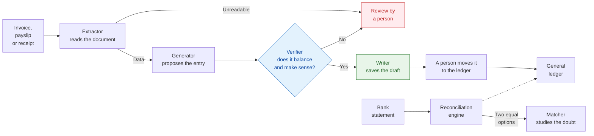
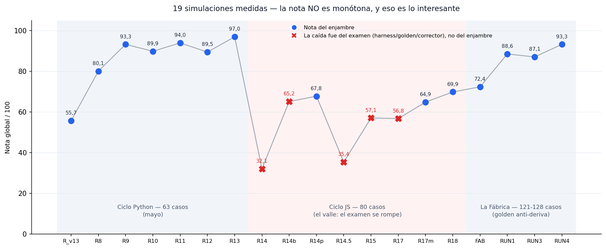

Versión en español: [README.md](README.md)

# Accounting with AI agents

Five specialised AI agents turn invoices, payslips and bank statements into accounting entries under the Spanish
**General Accounting Plan** (Plan General Contable). They work on the principle of least privilege: each agent gets
only the tools its step needs, and none of them can write to the general ledger.

The [project page](https://jleonceo.github.io/accounting-agent-swarm) tells the first chapter, May 2026, with three agents.

## How the work is split

A document goes through four agents, and a person approves the entry before it reaches the general ledger, the
official record of the accounts:

1. The **extractor** reads the original document, whether invoice, payslip or receipt, and returns its data.
2. The **generator** proposes the entry from that data, without seeing the document.
3. The **verifier** reviews the entry without knowing who proposed it and without any writing tool.
4. The **writer** saves the approved entry to a drafts table, separate from the ledger. A person decides when it
   moves to the ledger.

The fifth agent, the **matcher**, works separately, on bank reconciliation: when the engine that pairs each bank
movement with its entry finds two options that fit equally well, the matcher studies the doubt.

## Controls

Permissions are split so that no agent can do another agent's job. Each one has only these tools:

| Agent | Tools | Why |
|---|---|---|
| Extractor | read files | it is the only one that sees the original document, and it does not touch the database |
| Generator | read and search files, look up the account, check balances | it chooses the accounts and the third party, without writing to any table |
| Verifier | read and search files, check the balance, look for duplicates, check balances | it reviews the entry and has no writing tool at all |
| Writer | read files, check the balance, look for duplicates, write the draft | it is the only one that writes, and only to the drafts table |
| Matcher | read and search files, check balances | it studies the reconciliation doubts without writing |

There are three more controls, underneath the agents:

- **The database sets its own limit.** The user the agents connect with can only write to the drafts tables. If
  anyone tries to write to the ledger or delete a record, the database refuses, even if everything else fails.
- **A person decides** which entry moves from the drafts table to the ledger.
- **The accounting criteria are written down in reference documents**, not left to the model's memory. The
  generator looks up the company's standard entries and a library of entries under the
  Spanish General Accounting Plan. The extractor and the verifier look up the catalogue of customers, suppliers
  and employees. Those documents stay in the private project.

The sheets of the five agents, with their tool list exactly as they receive it, are in [`agentes/`](agentes/).
How a multi-agent system is checked to keep following its own rules is in
[gobernanza-agentes-verificada](https://github.com/jleonceo/gobernanza-agentes-verificada).

## Results

> Both figures were measured with the previous version of the system, in which a single agent, the validator,
> reviewed and saved the entry. The two test sets are different, so the figures are not compared with each other.

- In **June 2026**, over 128 documents, the system decided correctly in **97.7%** of cases whether to record the
  entry or stop it for review.
- In **July 2026**, with a larger test set, it scored **79.4 out of 100** and let through two documents that should
  have been stopped. The score adds up five things: the decision, the accuracy of the entry, the balance, the
  reason for each stop and the reconciliation.

Each measurement in detail:

- **June, 128 documents:** right decision in 125, exact entry in 81 of 84, balanced in all, right reason for
  stopping in 33 of 41 and correct reconciliation in 79 of 79. No wrong entry recorded.
- **27 June:** the best score, 94.2.
- **20 July:** the test set grows to 129 entries and 10 statements, and the score drops to 79.4. Two documents
  were recorded when they should have been stopped.
- **The big drops in the curve** (32.1, 35.4 and 57.1) came from faults in the test itself: a grader
  that could not read the validator's output, a run that stopped halfway and expected answers out of step with
  the database.

## How it is measured

Each measurement runs the documents through the agents, and a Python grader compares the output with the correct
answer, written before the measurement. It scores five things: whether the decision to record or stop was right,
whether the entry is exact in accounts and amounts, whether it balances, whether the reason for stopping was the
right one and whether the bank reconciliation matches the database.

The document, the expected entry and the bank movement of each case come from the same record. That way the
test set cannot drift away from the data.

## What this repository holds

It is the record of how the system was measured. It holds the report of each test, the program that launched each
one, the cause of each drop in score from one test to the next and the permissions sheet of the five agents, with
the tools each one has.

1. `evidencia/registro_de_runs.md` lists every measurement with its score and cause.
2. `evidencia/` also keeps the grader's June reports, as they came out, and what was left unresolved.
3. `eval/eval_enjambre_fabrica.js` is the program that launched each measurement, with local paths removed.
4. `eval/golden_muestra.json` holds 9 of the 128 test cases, with their correct answer.
5. `index.html`, `styles.css` and `script.js` make up the project page.
6. `agentes/` holds the sheets of the five agents, with each one's tool list.
7. `CHANGELOG.md` records what changes in each version.

## Limits

It cannot be run from here. The agents work on the private database of a fictitious company, and the accounting
criteria each agent follows stay in the private project.

- The July score cannot be compared with the earlier ones, because the test set was different and larger.
- The cases still failing are rare ones, such as the purchase option of a lease or an opening entry, and part of
  the failure is model variability.
- In September 2026 the validator was split into two agents: the verifier, which reviews without being able to
  write, and the writer, which only writes to the drafts table. What is measured here is the previous, four-agent
  version.
- In `evidencia/`, a false positive means recording a document that should have been stopped, and a false
  negative, stopping one that was fine. That is the reverse of the usual meaning in detection; it is kept so as
  not to break the link with reports already closed.
- The run numbering in this repository does not match the project's internal register. From 21 June runs are
  identified by date.

## Data

The data belongs to TechAcces SL, a fictitious company created for this project. Its ledger for four financial
years lives in a private MySQL database, with synthetic third parties and payroll.

## Related repositories

- [llm-eval-contable](https://github.com/jleonceo/llm-eval-contable): the evaluation of a single accounting skill,
  before the agents.
- [control-interno-fraude-ia](https://github.com/jleonceo/control-interno-fraude-ia): fraud tests on the general
  ledger.
- [tesoreria-forecast-ia](https://github.com/jleonceo/tesoreria-forecast-ia): cash forecast tested against the
  past, liquidity ratios and ageing.
- [gobernanza-skills-analiticas](https://github.com/jleonceo/gobernanza-skills-analiticas): the rules for
  changing the agents' instructions without breaking what already worked.

---

*Part of [Juan Luis León](https://github.com/jleonceo)'s portfolio · [juanluisleon.vercel.app](https://juanluisleon.vercel.app) · Licence [MIT](LICENSE)*
