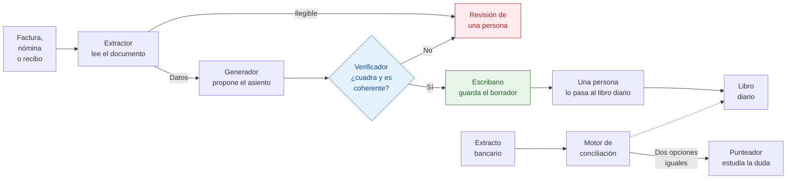

English version: [README.en.md](README.en.md)

# Contabilidad con agentes de IA

Cinco agentes de IA especializados convierten facturas, nóminas y extractos bancarios en asientos contables según el
**Plan General Contable**. Trabajan con el principio de mínimo privilegio: cada agente recibe solo las herramientas
que necesita su paso, y ninguno puede escribir en el libro diario.

La [página del proyecto](https://jleonceo.github.io/accounting-agent-swarm) cuenta el primer capítulo, el de mayo de 2026, con tres agentes.

## Cómo se reparte el trabajo

Un documento recorre cuatro agentes, y una persona aprueba el asiento antes de que llegue al libro diario, que es el
registro oficial de la contabilidad:

1. El **extractor** lee el documento original, sea factura, nómina o recibo, y devuelve sus datos.
2. El **generador** propone el asiento a partir de esos datos, sin ver el documento.
3. El **verificador** revisa el asiento sin saber quién lo propuso y sin ninguna herramienta de escritura.
4. El **escribano** guarda el asiento aprobado en una tabla de borradores, aparte del libro diario. El paso al libro
   diario lo decide una persona.

El quinto agente, el **punteador**, trabaja aparte, sobre la conciliación bancaria: cuando el motor que casa cada
movimiento del banco con su asiento encuentra dos opciones que cuadran igual, el punteador estudia la duda.

## Resultados

> Las dos cifras se midieron con la versión anterior del sistema, en la que un solo agente, el validador, revisaba y
> guardaba el asiento. Los dos exámenes son distintos, así que las cifras no se comparan entre sí.

- En **junio de 2026**, sobre 128 documentos, el sistema decidió bien en el **97,7 %** de los casos si había que
  registrar el asiento o pararlo para revisión.
- En **julio de 2026**, con un examen más grande, sacó **79,4 sobre 100** y dejó pasar dos documentos que había que
  parar. La nota suma cinco cosas: la decisión, la exactitud del asiento, el cuadre, el motivo de cada parada y la
  conciliación.

El detalle de cada medición:

- **Junio, 128 documentos:** decisión correcta en 125, asiento exacto en 81 de 84, cuadre en todos, motivo de
  parada correcto en 33 de 41 y conciliación correcta en 79 de 79. Ningún asiento erróneo registrado.
- **27 de junio:** la mejor nota, 94,2.
- **20 de julio:** el examen pasa a 129 asientos y 10 extractos, y la nota baja a 79,4. Dos documentos se
  registraron cuando había que pararlos.
- **Las caídas grandes de la curva** (32,1, 35,4 y 57,1) vinieron de fallos del propio examen: un
  corrector que no leía la salida del validador, una ejecución que se cortó a mitad y unas respuestas
  correctas desfasadas respecto a la base de datos.

## Cómo se mide

Cada medición pasa los documentos por los agentes y un corrector en Python compara el resultado con la respuesta
correcta, escrita antes de la medición. Puntúa cinco cosas: si la decisión de registrar o parar fue correcta, si el
asiento es exacto en cuentas e importes, si cuadra, si el motivo de parar era el bueno y si la conciliación
bancaria casa con la base de datos.

Los documentos, el asiento esperado y el movimiento bancario de cada caso salen de la misma ficha. Así el examen
no puede quedar desfasado respecto a los datos.

## Qué guarda este repositorio

Es el registro de cómo se midió el sistema. Contiene los informes de cada examen, el programa que lanzaba cada uno, la
causa de cada bajada de nota entre un examen y el siguiente y la ficha de permisos de los cinco agentes, con las
herramientas que tiene cada uno.

1. `evidencia/registro_de_runs.md` recoge cada medición con su nota y su causa.
2. `evidencia/` guarda también los informes del corrector de junio, tal como salieron, y lo que quedó sin
   resolver.
3. `eval/eval_enjambre_fabrica.js` es el programa que lanzaba cada medición, con las rutas locales quitadas.
4. `eval/golden_muestra.json` contiene 9 de los 128 casos del examen, con su respuesta correcta.
5. `index.html`, `styles.css` y `script.js` forman la página del proyecto.
6. `CHANGELOG.md` recoge lo que cambia en cada versión.

## Límites

Desde aquí no se puede ejecutar. Los agentes trabajan sobre la base de datos privada de una empresa ficticia, y el
criterio contable que sigue cada agente se queda en el proyecto privado.

- La nota de julio no se puede comparar con las anteriores, porque el examen era distinto y más grande.
- Los casos que siguen fallando son poco frecuentes, como la opción de compra de un leasing o un asiento de
  apertura, y parte del fallo es variabilidad del modelo.
- En septiembre de 2026 el validador se dividió en dos agentes: el verificador, que revisa sin poder escribir, y el
  escribano, que solo escribe en la tabla de borradores. Lo medido aquí es la versión anterior, de cuatro agentes.
- En `evidencia/`, falso positivo significa registrar un documento que había que parar, y falso negativo, parar
  uno que estaba bien. Es al revés de lo habitual en detección; se mantiene para no romper la relación con los
  informes ya cerrados.
- La numeración de las mediciones de este repositorio no coincide con la del registro interno del proyecto.
  Desde el 21 de junio se identifican por la fecha.

## Datos

Los datos son de TechAcces SL, una empresa ficticia creada para este proyecto. Su libro diario de cuatro ejercicios
vive en una base MySQL privada, con terceros y nóminas sintéticos.

## Repositorios relacionados

- [llm-eval-contable](https://github.com/jleonceo/llm-eval-contable): la evaluación de una sola skill contable,
  antes de los agentes.
- [control-interno-fraude-ia](https://github.com/jleonceo/control-interno-fraude-ia): pruebas de fraude sobre el
  libro diario.
- [tesoreria-forecast-ia](https://github.com/jleonceo/tesoreria-forecast-ia): previsión de caja medida contra el
  pasado, ratios de liquidez y antigüedad de saldos.
- [gobernanza-skills-analiticas](https://github.com/jleonceo/gobernanza-skills-analiticas): las reglas para
  cambiar las instrucciones de los agentes sin empeorar lo que ya funcionaba.

---

*Parte del portfolio de [Juan Luis León](https://github.com/jleonceo) · [juanluisleon.vercel.app](https://juanluisleon.vercel.app) · Licencia [MIT](LICENSE)*
