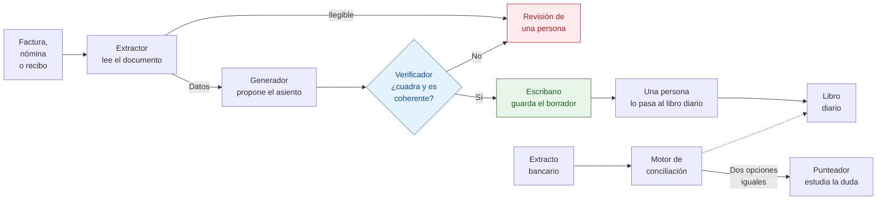
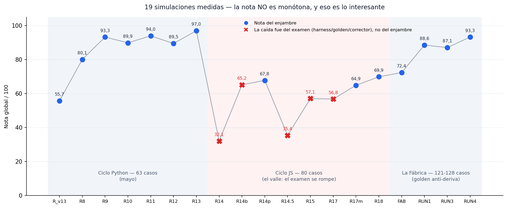

English version: [README.en.md](README.en.md)

# Contabilidad con agentes de IA

Cinco agentes de IA especializados convierten facturas, nóminas y extractos bancarios en asientos contables según el
**Plan General Contable**. Trabajan con el principio de mínimo privilegio: cada agente recibe solo las herramientas
que necesita su paso, y ninguno puede escribir en el libro diario.

Página del proyecto: [jleonceo.github.io/accounting-agent-swarm](https://jleonceo.github.io/accounting-agent-swarm)

## Cómo se reparte el trabajo

Un documento recorre cuatro agentes, y una persona aprueba el asiento antes de que llegue al libro diario, que es el
registro oficial de la contabilidad:

1. El **extractor** lee el documento original, sea factura, nómina o recibo, y devuelve sus datos.
2. El **generador** propone el asiento a partir de esos datos, sin ver el documento.
3. El **verificador** revisa el asiento sin saber quién lo propuso y sin ninguna herramienta de escritura.
4. El **escribano** guarda el asiento aprobado en una tabla de borradores, aparte del libro diario. El paso al libro
   diario lo decide una persona.

El quinto agente, el **punteador**, trabaja aparte, sobre la conciliación bancaria: cuando el motor que casa cada
movimiento del banco con su asiento encuentra dos opciones que cuadran igual, el punteador estudia la duda.

## Controles

Los permisos se reparten para que ningún agente pueda hacer el trabajo de otro. Cada uno tiene solo estas
herramientas:

| Agente | Herramientas | Por qué |
|---|---|---|
| Extractor | leer y buscar ficheros | es el único que ve el documento original. No toca la base de datos |
| Generador | leer y buscar ficheros, buscar la cuenta contable, consultar saldos | elige las cuentas y el tercero, sin escribir en ninguna tabla |
| Verificador | leer y buscar ficheros, comprobar el cuadre, buscar duplicados, consultar saldos | revisa el asiento y no tiene ninguna herramienta de escritura |
| Escribano | leer ficheros, comprobar el cuadre, buscar duplicados, escribir el borrador | es el único que escribe, y solo en la tabla de borradores |
| Punteador | leer y buscar ficheros, consultar saldos | estudia las dudas de la conciliación sin escribir |

Hay tres controles más, por debajo de los agentes:

- **La base de datos pone su propio límite.** El usuario con el que entran los agentes solo puede escribir en las
  tablas de borradores. Si alguien intenta escribir en el libro diario o borrar un registro, la base de datos lo
  rechaza, aunque falle todo lo demás.
- **Una persona decide** qué asiento pasa de la tabla de borradores al libro diario.
- **El criterio contable está escrito en documentos de consulta**, que el agente abre antes de decidir. El generador
  consulta los asientos tipo de la empresa y una biblioteca de asientos del Plan General
  Contable. El extractor y el verificador consultan el catálogo de clientes, proveedores y empleados. Esos
  documentos se quedan en el proyecto privado.

Las fichas de los cinco agentes, con su lista de herramientas tal como la reciben, están en [`agentes/`](agentes/).
Cómo se vigila que un sistema de agentes siga cumpliendo sus propias reglas está en
[gobernanza-agentes-verificada](https://github.com/jleonceo/gobernanza-agentes-verificada).

## Resultados

> Las dos cifras se midieron con la versión anterior del sistema, en la que un solo agente, el validador, revisaba y
> guardaba el asiento. Los dos exámenes son distintos, así que las cifras no se comparan entre sí.

- En **junio de 2026**, sobre 128 documentos, el sistema decidió bien en el **97,7 %** de los casos si había que
  registrar el asiento o pararlo para revisión.
- En **julio de 2026**, con un examen más grande, sacó **79,4 sobre 100** y dejó pasar dos documentos que había que
  parar. La nota suma cinco cosas: la decisión, la exactitud del asiento, el cuadre, el motivo de cada parada y la
  conciliación.

El detalle de cada medición:

- **Junio, 128 documentos:** decisión correcta en 125, asiento exacto en 81 de 84, cuadre en todos, motivo de
  parada correcto en 33 de 41 y conciliación correcta en 79 de 79. Tres asientos se registraron con errores: dos
  vacíos (ACR-41000006 y SIN-25) y uno con líneas de más (SIN-03). Habrían llegado a la tabla de borradores, donde
  una persona revisa cada asiento antes del libro diario.
- **27 de junio:** la mejor nota de junio, 94,2 sobre 100.
- **20 de julio:** el examen pasa a 129 asientos y 10 extractos, y la nota es 79,4. Dos documentos se
  registraron cuando había que pararlos.
- **Las caídas grandes de la curva** (32,1, 35,4 y 57,1) vinieron de fallos del propio examen: un
  corrector que no leía la salida del validador, una ejecución que se cortó a mitad y unas respuestas
  correctas desfasadas respecto a la base de datos.

## Cómo se mide

Cada medición pasa los documentos por los agentes y un corrector en Python compara el resultado con la respuesta
correcta, escrita antes de la medición. Puntúa cinco cosas: si la decisión de registrar o parar fue correcta, si el
asiento es exacto en cuentas e importes, si cuadra, si el motivo de parar era el bueno y si la conciliación
bancaria casa con la base de datos. Los agentes funcionan con Claude Sonnet, de Anthropic; desde el 21 de junio,
con Sonnet 4.6. Cada nota sale de una sola ejecución.

Los documentos, el asiento esperado y el movimiento bancario de cada caso salen de la misma ficha. Así el examen
no puede quedar desfasado respecto a los datos.

## Qué guarda este repositorio

Es el registro de cómo se midió el sistema. Contiene los informes de cada examen, el programa que lanzaba cada uno, la
causa de cada bajada de nota entre un examen y el siguiente y la ficha de permisos de los cinco agentes, con las
herramientas que tiene cada uno.

1. `evidencia/registro_de_runs.md` recoge cada medición, de mayo a julio, con su nota y su causa.
2. `evidencia/` guarda también los informes del corrector de junio, tal como salieron, y lo que quedó sin
   resolver.
3. `eval/eval_enjambre_fabrica.js` es el programa que lanzaba cada medición, con las rutas locales quitadas.
4. `eval/golden_muestra.json` contiene 9 de los 128 casos del examen, con su respuesta correcta.
5. `index.html`, `styles.css` y `script.js` forman la página del proyecto.
6. `agentes/` guarda las fichas de los cinco agentes, con la lista de herramientas de cada uno.
7. `CHANGELOG.md` recoge lo que cambia en cada versión.

## Límites

Desde aquí no se puede ejecutar. Los agentes trabajan sobre la base de datos privada de una empresa ficticia, y el
criterio contable que sigue cada agente se queda en el proyecto privado.

- La nota de julio no se puede comparar con las anteriores, porque el examen era distinto y más grande.
- En ocho casos sin documento el enunciado ya trae la respuesta: SIN-14 a SIN-17 y SIN-23 a SIN-25 llevan el
  asiento escrito, y SIN-18 dice que hay que pararlo. Esos ocho miden si el sistema copia bien, no su criterio.
- La conciliación usa un extracto sacado del propio libro diario, así que cada movimiento tiene su asiento. Falta
  probarla con movimientos que no estén en el diario.
- Los arreglos se hicieron mirando el mismo examen. No hay un lote de casos reservado que no se haya usado para
  ajustar. Cada nota sale de una sola ejecución. Falta compararlo con un solo agente y medir el coste.
- Los casos que siguen fallando son poco frecuentes, como la opción de compra de un leasing o un asiento de
  apertura, y parte del fallo es variabilidad del modelo.
- En septiembre de 2026 el validador se dividió en dos agentes: el verificador, que revisa sin poder escribir, y el
  escribano, que solo escribe en la tabla de borradores. Lo medido aquí es la versión anterior, de cuatro agentes.
- En `evidencia/`, falso positivo significa registrar un documento que había que parar, y falso negativo, parar
  uno que estaba bien. Es al revés de lo habitual en detección; se mantiene para no romper la relación con los
  informes ya cerrados.
- La numeración de las mediciones de este repositorio no coincide con la del registro interno del proyecto.
  Desde el 21 de junio se identifican por la fecha.

## Datos

Los datos son de TechAcces SL, una empresa ficticia creada para este proyecto. Su libro diario de cuatro ejercicios
vive en una base MySQL privada, con terceros y nóminas sintéticos.

## Repositorios relacionados

- [llm-eval-contable](https://github.com/jleonceo/llm-eval-contable): la evaluación de una sola skill contable,
  antes de los agentes.
- [control-interno-fraude-ia](https://github.com/jleonceo/control-interno-fraude-ia): pruebas de fraude sobre el
  libro diario.
- [tesoreria-forecast-ia](https://github.com/jleonceo/tesoreria-forecast-ia): previsión de caja medida contra el
  pasado, ratios de liquidez y antigüedad de saldos.
- [gobernanza-skills-analiticas](https://github.com/jleonceo/gobernanza-skills-analiticas): las reglas para
  cambiar las instrucciones de los agentes sin empeorar lo que ya funcionaba.

---

*Parte del portfolio de [Juan Luis León](https://github.com/jleonceo) · [juanluisleon.vercel.app](https://juanluisleon.vercel.app) · Licencia [MIT](LICENSE)*
